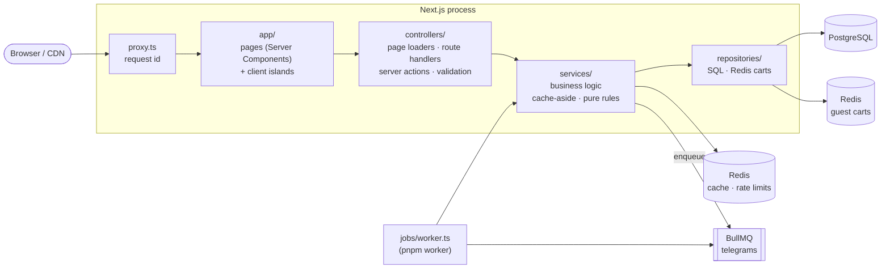
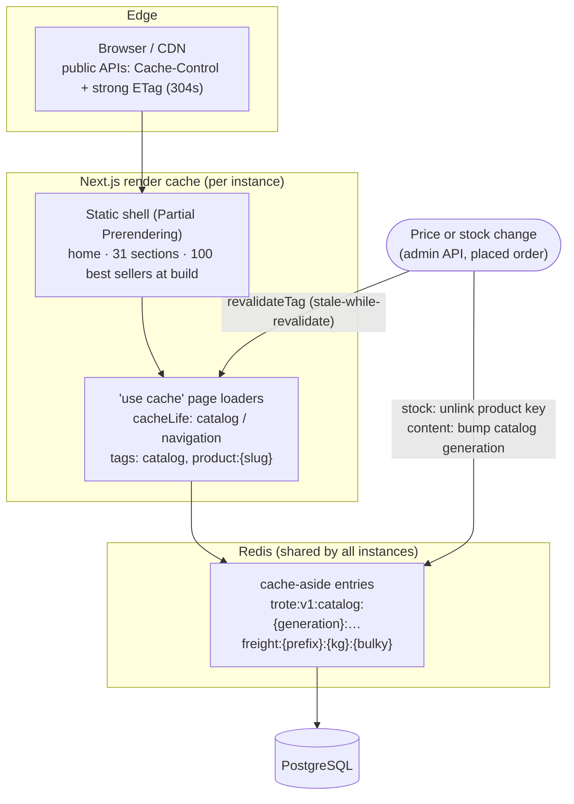

# Armazém & Trote

Secos & molhados since 1887, delivered at the pace of a hoof: by donkey, horse or cart, with
freight priced in _léguas_. A portfolio e-commerce built from a Claude Design mock-up, keeping
its look and humour intact, on a deliberately boring and fast stack: Next.js 16 (App Router,
Server Components, Cache Components), PostgreSQL + Drizzle, Redis + BullMQ. Payments and
deliveries are mocked.

- **10,000 products**, 18,575 variants, 30,000 reviews, seeded deterministically in ~5 s.
- **Every page renders from one page-level service call**, cached in two layers.
- **≤ 148 KB of gzipped JS per route**, CLS ≤ 0.008, LCP ≈ 1.5 s on throttled mobile.
- **Cached reads p95 25–44 ms** under load on a single instance; zero errors.

---

## Contents

1. [Getting started](#getting-started)
2. [Architecture](#architecture)
3. [Caching](#caching)
4. [Domain notes](#domain-notes)
5. [Testing](#testing)
6. [Performance results](#performance-results)
7. [Architecture decision records](#architecture-decision-records)
8. [Known trade-offs](#known-trade-offs)

---

## Getting started

Requirements: Node ≥ 22.12 (24 recommended, see `.nvmrc`), pnpm 10, Docker.

```bash
pnpm install
cp .env.example .env
pnpm dev
```

`pnpm dev` starts Postgres and Redis in Docker, applies migrations, seeds the catalog on the
first run, then runs Next.js (http://localhost:3000) and the background worker side by side.
`/api/health` reports the Postgres and Redis status.

Host ports default to **5434** (Postgres) and **6380** (Redis) to stay clear of local installs;
override with `POSTGRES_HOST_PORT` / `REDIS_HOST_PORT`.

| Script                                         | What it does                                                |
| ---------------------------------------------- | ----------------------------------------------------------- |
| `pnpm dev`                                     | Infra up → migrate → seed if empty → `next dev` + worker    |
| `pnpm build` / `pnpm start`                    | Production build (needs a seeded database) / serve it       |
| `pnpm worker`                                  | BullMQ worker: sends the order "telegrams"                  |
| `pnpm db:generate` / `db:migrate`              | New migration from `src/models` / apply pending migrations  |
| `pnpm db:seed [--products N] [--seed S]`       | Replace all data with a deterministic catalog (default 10k) |
| `pnpm db:explain`                              | EXPLAIN ANALYZE every hot query (`db/query-plans.sql`)      |
| `pnpm test` / `test:unit` / `test:integration` | Vitest; integration runs against real Postgres and Redis    |
| `pnpm test:e2e`                                | Playwright, desktop + mobile, against a production build    |
| `pnpm test:load`                               | k6 load test (Docker) against `BASE_URL`                    |
| `pnpm lint` / `typecheck` / `format`           | ESLint (with layering rules), `tsc`, Prettier               |

<details>
<summary>Configuration (validated with zod at boot; the server refuses to start on bad env)</summary>

| Variable                              | Purpose                                                      |
| ------------------------------------- | ------------------------------------------------------------ |
| `DATABASE_URL`                        | Pooled connection used by the app                            |
| `DATABASE_URL_DIRECT`                 | Direct connection for migrations and seeding                 |
| `DATABASE_POOL_MAX`                   | Connections per process (default 10)                         |
| `DATABASE_PREPARED_STATEMENTS`        | `false` behind PgBouncer in transaction mode                 |
| `DATABASE_LOG_QUERIES`                | Log every SQL statement with its request id                  |
| `REDIS_URL`                           | Cache, guest carts, rate limits and the job queue            |
| `CART_COOKIE_SECRET`                  | Signs the guest-cart cookie (≥ 32 chars)                     |
| `ADMIN_API_TOKEN`                     | Enables `PATCH /api/admin/produtos/{slug}` (reprice/restock) |
| `TEST_DATABASE_URL`, `TEST_REDIS_URL` | Disposable targets for integration tests                     |

</details>

**PgBouncer.** `docker compose --profile pooler up -d`, point `DATABASE_URL` at port 6432 and
set `DATABASE_PREPARED_STATEMENTS=false`. Migrations keep using `DATABASE_URL_DIRECT`.

---

## Architecture



```
src/
  app/            routes and pages — views only
  components/     design system: product tag, price, horseshoes, freight card, line item,
                  drawer, road stepper, telegram toast, the SVG animals
  controllers/    page loaders (`use cache` + tags), route handlers, server actions
  services/       business logic; *.rules.ts are pure functions (freight, cart totals)
  repositories/   database access only (Postgres via Drizzle, carts in Redis)
  models/         Drizzle schema, domain types and constants
  validators/     zod/mini schemas shared by browser and server
  lib/            config, db, redis, cache, rate limiter, logger, queue
  jobs/           BullMQ worker and processors
db/               migrations, migration runner, seed, query plans
tests/            unit · integration · e2e · load
```

**Layering is enforced, not just documented.** `eslint.config.mjs` lists, per folder, what may
not be imported: views can't reach services or the database, controllers can't touch
repositories, services can't import `lib/db`, repositories can't cache. Type-only imports are
always allowed.

**Request budget.** Each page's initial render calls exactly one loader, which calls exactly
one page-level service (`getHomePage`, `getListingPage`, `getProductPage`, `getSearchPage`,
`getCart`). Inside, independent queries run in parallel — the product page is four slug-keyed
queries at once, never a waterfall — and the cart hydrates any number of lines with one query.
The browser only calls the server for user actions: add to cart, quantities, coupon, freight
(debounced and cancellable autocomplete; a stale freight quote is aborted by the newer one).

**Cross-cutting concerns live in one place each:** `controllers/http.ts` wraps every route
handler (request id, error → HTTP mapping, access log with status, timing and SQL statement
count — more than 10 statements logs an N+1 warning) and `controllers/actions.ts` does the same
for server actions, returning `ActionResult` values instead of throwing.

---

## Caching



| What                        | Where it lives                    | Lifetime                    | Invalidated by                    |
| --------------------------- | --------------------------------- | --------------------------- | --------------------------------- |
| Home, listings, search, PDP | `use cache` loader + Redis entry  | 1 h render / 10–30 min data | `catalog` tag + generation bump   |
| Product stock               | same as PDP                       | 30 min                      | `product:{slug}` tag + key unlink |
| Section tree, navigation    | `use cache` + Redis               | 1 day / 6 h                 | `catalog` tag + generation bump   |
| Freight quote               | Redis, by CEP prefix + kg + bulky | 1 day                       | freight generation                |
| Autocomplete, freight API   | Browser / CDN                     | 1 min / 1 h (+ SWR)         | ETag revalidation                 |
| Guest cart                  | Redis hash, signed cookie key     | 30 days, sliding            | written to Postgres when ordered  |

Cart, checkout and confirmation never enter a shared cache; in the shell they are dynamic holes
(the header's cart badge streams in per visitor).

---

## Domain notes

- **Money** is integer cents everywhere — columns, cache, wire. Totals are recomputed on the
  server from catalog prices by pure functions (`services/cart.rules.ts`); the browser only
  ever sends what it wants, never what it costs. Check constraints in Postgres back this up
  (`total = subtotal − discount + freight`, `line_total = unit × quantity`).
- **Freight** (`services/freight.rules.ts`, fully unit-tested, no I/O): CEP prefix → region by
  first digit → km from Ouro Fino → léguas (6.6 km). Price = base + per légua + per extra kg;
  ETA = usual window + a day per stretch of road + road conditions ("Chuva na estrada",
  "Rio cheio") picked deterministically from the prefix's digit sum, so neighbours share a
  cached quote. Bulky goods go by charrete only.
- **Search**: Portuguese full-text (`trote_pt` = `portuguese` + `unaccent`, GIN on a generated
  `tsvector`) OR trigram similarity on the accent-folded name (GiST), ranked by text relevance
  nudged by sales. The trigram leg catches typos and plurals the stemmer misses
  ("lampiões" → "lampião"). Autocomplete matches word prefixes first (best sellers first), then
  falls back to nearest-neighbour typo matching.
- **Orders**: one transaction locks the stock rows in variant-id order (no deadlocks between
  concurrent checkouts), reserves stock, snapshots the cart and writes the order and its lines.
  A client-generated idempotency key makes retries and double clicks return the same order; a
  unique cart id stops the same cart from being ordered twice in two tabs.
- **Telegram emails** are BullMQ jobs (`jobs/`), retried with exponential backoff and logged
  instead of sent. The job id is the order id, so a re-enqueue is a no-op.
- **Rate limiting**: Redis sliding-window counters (one Lua call) on search, freight, cart and
  checkout; fails open if Redis is down.

---

## Testing

| Suite            | What it covers                                                                                                                                                                                                                                                                                                                                                     | Count |
| ---------------- | ------------------------------------------------------------------------------------------------------------------------------------------------------------------------------------------------------------------------------------------------------------------------------------------------------------------------------------------------------------------ | ----- |
| Unit             | freight rules, cart arithmetic, pagination cursors, section tree, validators, cache-aside (incl. stampede and Redis-down), HTTP helpers (ETag/304, error mapping), seed generator                                                                                                                                                                                  | 103   |
| Integration      | repositories and services against real Postgres + Redis: keyset pages equal a plain `ORDER BY` in every sort, both directions; cache hits issue zero SQL; price/stock invalidation; freight caching; idempotent checkout; **two carts racing for the last unit sell it once**; **concurrent double submit places one order**; full rollback on mid-order stock-out | 59    |
| E2E (Playwright) | search → product → cart → checkout → telegram; bulky freight; empty search; filters and pagination — desktop and mobile                                                                                                                                                                                                                                            | 8     |

```bash
pnpm test           # unit + integration (needs `docker compose up -d`)
pnpm build && pnpm test:e2e
```

CI (`.github/workflows/ci.yml`) runs format, lint, typecheck, unit, integration, build and e2e
against Postgres and Redis service containers.

---

## Performance results

Measured on an Apple Silicon laptop with Postgres, Redis and the load generator on the same
machine, against `pnpm build && pnpm start` (a single Node process).

### JavaScript per route (first load, gzipped)

| Route                | JS       |
| -------------------- | -------- |
| `/`                  | 143.7 KB |
| `/secao/[slug]`      | 143.0 KB |
| `/mercadoria/[slug]` | 143.7 KB |
| `/busca`             | 141.1 KB |
| `/carroca`           | 146.2 KB |
| `/encomenda`         | 147.8 KB |

About 130 KB of that is React and the Next.js router; the shop's own code is 12–18 KB per
page. Server Components by default; the cart drawer, the freight illustrations and the checkout
schemas are loaded on first use.

### Lighthouse, mobile

| Page    | Perf (simulated) | Perf (devtools throttling) | LCP   | CLS   | TBT   | A11y | SEO |
| ------- | ---------------- | -------------------------- | ----- | ----- | ----- | ---- | --- |
| Home    | 89–90            | 99                         | 1.6 s | 0.004 | 70 ms | 96   | 100 |
| Section | 88–89            | 99                         | 1.5 s | 0.008 | 80 ms | 96   | 100 |
| Product | 90–92            | 99                         | 1.5 s | 0.003 | 90 ms | 97   | 100 |

_Devtools throttling_ applies a real slow-4G network and 4× CPU slowdown; _simulated_ is
Lighthouse's default model. The gap is the design's seven typefaces (~170 KB above the fold
even after subsetting): with fonts blocked, the simulated score is 96. See
[Known trade-offs](#known-trade-offs).

### Server latency, uncontended (2 connections)

| Endpoint                         | p50   | p99   |
| -------------------------------- | ----- | ----- |
| `/` (static shell + cart island) | 16 ms | 25 ms |
| `/secao/iluminacao`              | 26 ms | 39 ms |
| `/mercadoria/lampiao`            | 12 ms | 19 ms |
| `/busca?q=…`                     | 24 ms | 33 ms |
| `/api/busca/sugestoes`           | 1 ms  | 2 ms  |
| `/api/frete`                     | 1 ms  | 2 ms  |

### Load (k6, `tests/load/k6.js`), one Node process

| Load (req/s: cached + uncached + writes) | Cached p95 | Uncached p95 | Writes p95 | Errors |
| ---------------------------------------- | ---------- | ------------ | ---------- | ------ |
| 52 (40 + 8 + 4)                          | 25 ms      | 55 ms        | 60 ms      | 0 %    |
| 90 (70 + 14 + 6)                         | 44 ms      | 67 ms        | 84 ms      | 0 %    |
| 116 (90 + 18 + 8)                        | 143 ms     | 218 ms       | 329 ms     | 0 %    |

Targets: cached p95 < 150 ms, uncached and writes p95 < 300 ms. A single process holds them up
to ~100 req/s of this mix; beyond that the event loop queues and you scale out with more
processes (they share nothing but Postgres and Redis). Writes degrade first because every k6
write creates a new cart, and setting the cart cookie makes Next re-render the route in the
action response — a real visitor pays that once.

### Query plans (`pnpm db:explain`, 10k products)

| Query                                              | Plan                                               | Time      |
| -------------------------------------------------- | -------------------------------------------------- | --------- |
| Listing, default order, first page                 | backward scan of `products_popularity_idx`         | 0.5 ms    |
| Section listing, price desc, deep keyset page      | index-only scans of `products_category_price_idx`  | 4.7 ms    |
| Search "cafe" (FTS OR trigram), ranked             | BitmapOr of GIN + GiST, top-N sort                 | 11 ms     |
| Autocomplete, word prefix                          | backward scan of `products_popularity_idx`, filter | 0.3 ms    |
| Autocomplete, typo fallback                        | GiST KNN on `products_search_name_trgm_idx`        | 6.3 ms    |
| Product page: variants + stock / letters / related | unique slug index, then PK / FK indexes            | ≤ 0.13 ms |
| Cart hydration, 10 lines                           | PK lookups, one query                              | 0.15 ms   |
| Checkout stock lock                                | PK, `FOR UPDATE` in id order                       | < 0.1 ms  |

Every migration comments each index with the query it serves.

---

## Architecture decision records

### ADR 1 — One page-level service per page

**Context.** Pages that assemble themselves from many small fetches create waterfalls, duplicate
queries and cache keys nobody owns.
**Decision.** Each page calls one loader → one service (`getProductPage(slug)` …) returning a
plain, serializable read model. The service owns its queries (in parallel), its cache key and
its invalidation. Client components only call the server for user actions.
**Consequences.** One place to cache, measure and test per page; pages are thin views. Services
return slightly more than any single component needs, which is fine at this size.

### ADR 2 — Keyset (cursor) pagination

**Context.** `OFFSET n` scans and discards n rows, so deep pages get slower, and rows shift when
the catalog changes between clicks.
**Decision.** Listings and search page on `(sort value, id)` tuples with composite indexes per
sort; cursors are opaque base64url positions; going back flips the comparison and order.
**Consequences.** Every page costs the same, and results are stable. You can't jump to page 40,
so the design's numbered coins show the current page and its neighbours. Totals come from a
separate, cached `count(*)`.

### ADR 3 — Two cache layers, invalidated explicitly

**Context.** We want CDN-servable HTML for catalog pages and a cache shared across instances
for data, without serving stale prices.
**Decision.** Next's Cache Components (`use cache` + `cacheLife` + `cacheTag`) cache rendered
output and build the static shell; underneath, services do Redis cache-aside. A stock change
unlinks one product key and revalidates `product:{slug}`; a content change (price, name) bumps
the catalog generation — every catalog key embeds it, so all listings and searches miss at once
without a scan — and revalidates the `catalog` tag. TTLs are only a backstop.
**Consequences.** Cheap, precise invalidation without tracking which listing contains which
product. Next's default render cache is per instance; across instances, tag revalidation needs a
shared cache handler (`use cache: remote`) — Redis data stays consistent either way.

### ADR 4 — Cache Components and Partial Prerendering

**Context.** Every page shows a per-visitor cart badge; in the classic model that makes every
page fully dynamic.
**Decision.** Enable `cacheComponents` and `partialPrefetching`. The static shell (catalog
content) is prerendered; the cart island reads the cookie inside `<Suspense>` and streams in.
**Consequences.** CDN-friendly HTML with per-visitor parts. Unknown products render on first
visit and are then cached. Because the status line is sent before a streamed lookup finishes,
unknown slugs answer 200 with the 404 page and `noindex`.

### ADR 5 — GiST, not GIN, for autocomplete trigrams

**Context.** Autocomplete needs the top 5 names for a short, partial term.
**Decision.** GiST trigram index: it can return nearest neighbours in distance order. Measured
on 10k products for "ca": GIN 63 ms (scores and sorts 3,400 matches) vs GiST 13.6 ms; the index
is less than half the size. Prefix matches go through the popularity index first.
**Consequences.** Fast suggestions with best sellers first; GiST is slower to build and update,
irrelevant for a catalog that changes rarely.

### ADR 6 — One Redis with `noeviction`

**Context.** Cache, guest carts, rate limits and the job queue share one Redis in this project.
**Decision.** `noeviction` (BullMQ requires it, and carts must never be evicted silently),
AOF persistence, every cache entry with a TTL.
**Consequences.** Simple to run. In production, split cache (`allkeys-lru`) from carts and
queue (`noeviction`) so a cache spike can never block writes.

---

## Known trade-offs

- **Lighthouse simulated score (88–92) vs ≥ 95.** The design uses seven typefaces. They are
  self-hosted, subset to the characters Portuguese text needs (−25 %), only the two display
  faces are preloaded, and below-the-fold sections use `content-visibility` so their fonts load
  later. With real throttling the pages score 99 (LCP 1.5 s); Lighthouse's simulation charges
  every font fetched before first paint to LCP. Reaching 95 there means dropping faces (or
  `font-display: optional`, i.e. fallback fonts on a first visit) — a design decision, not an
  engineering one.
- **Product photos** are the design's typographic plates (the italic initial), so there is no
  raster image to hand to `next/image`; `ProductPhoto` is the single place to swap one in.
- **`X-Forwarded-For`** identifies clients for rate limiting. Deploy behind a proxy that
  overwrites it; otherwise clients can spoof their way around the limits.
- **Telegram jobs** are enqueued right after the order commits. If Redis is down at that
  instant the order stands and the failure is logged; a transactional outbox would make the
  hand-off durable.
- **Mobile header** stacks sign, cart and search on three rows exactly as the design's
  flex-wrap rules produce; it is tall on phones by design.
